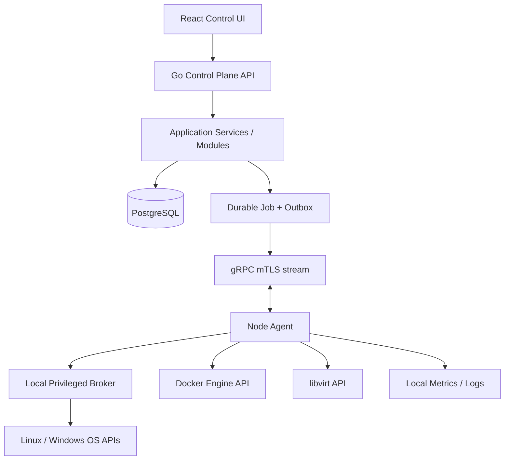

# System Architecture

## Overview

Use a **modular monolith Control Plane** plus **per-node Agent** and **narrow privileged broker**. This is a deliberate first architecture: it is simpler to build and operate than early microservices while keeping the node boundary and module interfaces explicit.

## Components

### Control Plane

- Linux-first deployment.
- Go HTTP API using `net/http` plus `chi` routing.
- Modular application services with explicit interfaces.
- PostgreSQL source of truth.
- Background worker for durable tasks and outbox delivery.
- gRPC server for Agent communication; mTLS required.
- React SPA served behind TLS reverse proxy.
- Initially one binary/process family or a small set of processes; avoid splitting every module into a microservice.

### Node Agent

- Separate Go binary for Linux and Windows.
- Dials Control Plane outbound over TLS/mTLS.
- Reports node facts, Agent version, installed adapters, capability set and heartbeat.
- Receives typed operation envelopes; validates schema, scope, deadline and idempotency key.
- Never accepts arbitrary shell strings or a generic `exec` operation.
- Routes privileged work to a local broker; broker is separately permissioned and has a tiny operation surface.

### Privileged Broker

- Linux: local Unix domain socket with strict owner/group/mode and peer credential checks; allowlisted typed operations only. It may call native APIs or fixed executables with separately validated argument arrays.
- Windows: named pipe with restrictive ACL; uses SCM, Event Log, firewall and other native interfaces.
- No network listener. No generic command execution. Log every privileged action with correlation ID.

### Database

- PostgreSQL holds users, roles, nodes, certificates metadata, capabilities, task state, operation records, audit log, settings and provider references.
- Encrypt secrets at rest using envelope encryption; master key is outside database and stored in OS-protected secret file or external secret manager. Never store a key beside its ciphertext.
- Time-series retention should be controlled; do not store every high-frequency metric indefinitely in relational tables. Initial metrics can be summarized/retained with bounded periods; later use Prometheus or a dedicated TSDB.

## Data flow: service restart

1. User requests a restart for a specific registered node and service.
2. API authenticates user, checks RBAC, node scope and operation capability.
3. API validates service identifier against node's allowed service inventory and creates a durable task + audit event in one transaction/outbox pattern.
4. Agent receives task through authenticated gRPC stream.
5. Agent validates task schema, expiry, operation version and idempotency key.
6. Broker validates operation and uses native service manager API / fixed allowlisted action.
7. Agent returns structured result; Control Plane updates task and audit records.
8. UI displays success, failure or partial state with correlation ID.

## Deployment topology

- Development: local compose for Postgres and optional observability dependencies; app processes run locally or in containers.
- Single-node: Control Plane and Agent may coexist on a dedicated management node, but remain separate services and security boundaries.
- Multi-node: one Control Plane manages multiple Agents; agents establish outbound connections. Network segmentation and per-node certificate identity are mandatory.
- HA Control Plane is future work. Do not promise HA in the initial version.

## Failure model

A node being offline must not block other nodes. Task state distinguishes `queued`, `dispatched`, `accepted`, `running`, `succeeded`, `failed`, `cancelled`, `expired`, `unknown` and `partial`, matching the Durable Task Lifecycle document. The system must not mark a task succeeded merely because it was delivered. If connection drops during an operation, reconcile desired/current state before retrying non-idempotent actions.
